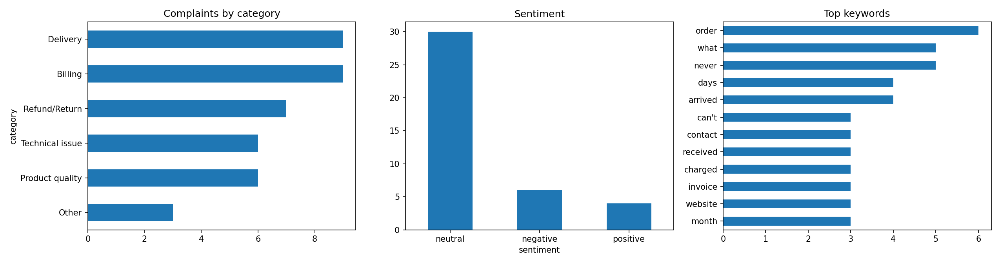

# Audio-to-Insights: Customer Complaint Analysis Pipeline

A Python pipeline that turns voice recordings of customer complaints into structured data. It transcribes audio with the OpenAI Whisper API, loads the text into pandas, classifies each complaint by topic, and reports on accuracy, sentiment and common keywords.

**Stack:** Python · OpenAI Whisper API · pandas · TextBlob · Matplotlib · Google Colab



## Results

| Metric | Result |
|---|---|
| Recordings analyzed | 40 (4.5 minutes of audio, `.ogg`) |
| Transcription accuracy | 96.9% |
| Complaint categorization accuracy | 92.5% (37 of 40) |
| Average speaking rate | 136 words per minute |
| Average transcript length | 15 words |
| Most common categories | Billing (9), Delivery (9), Refund/Return (7) |

## How it works

```
Audio files (.ogg) ──► Whisper transcription ──► pandas DataFrame ──► Feature engineering
                                                                              │
                         Charts + CSV  ◄── Accuracy check vs. script ◄── Category + sentiment
```

1. **Collect data.** I wrote 50 realistic complaint sentences across six categories and recorded 40 of them in my own voice (WhatsApp voice notes, `.ogg`).
2. **Transcribe.** Each file is sent to `whisper-1` through the OpenAI API.
3. **Structure.** Transcripts go into a pandas DataFrame with one row per recording.
4. **Engineer features.** Word count, audio duration (via `mutagen`), words per minute, sentiment polarity (TextBlob) and a complaint category.
5. **Categorize.** A keyword-rule classifier assigns one of: Billing, Delivery, Product quality, Refund/Return, Technical issue, or Other.
6. **Validate.** Each transcript is matched to its closest original sentence. That gives transcription accuracy (text similarity) and category accuracy (against my labels).
7. **Report.** Charts and a results CSV.

## Repository contents

| File | Description |
|---|---|
| `complaint_analysis.ipynb` | The full notebook, run top to bottom |
| `analysis_results.csv` | Per-recording results: transcript, metrics, predicted and true category, accuracy |
| `summary.png` | Complaints by category, sentiment, top keywords |

## Run it yourself

1. Open the notebook in Google Colab.
2. Upload your audio files to a folder, then set `AUDIO_DIR` in the notebook to that path.
3. Run the cells in order. You will be asked for an OpenAI API key (it is not stored in the notebook).

Supported audio formats: mp3, wav, m4a, mp4, webm, ogg, flac (25 MB per file limit).

**Requirements** (installed in the first cell):
```
pip install openai textblob mutagen pandas matplotlib
```

**Cost:** Whisper is billed per minute of audio, so transcribing these 40 clips costs only a few cents.

## Findings and limitations

- **Transcription was strong, with predictable errors.** Many apparent mismatches are formatting, such as "$49" against "forty-nine dollars". Real errors were rare, for example "service phase" for "service fee" and "phone tampered" for "phone I received has a".
- **Keyword rules are brittle.** All 3 categorization errors came from overly literal matching:
  - "arrived with the missing part" was labeled Delivery because of the word "arrived".
  - "cancelled my order... you still shipped it" matched no keyword.
  - "payment page showed an error... still charged" was labeled Billing instead of Technical issue.
- **Sentiment analysis was weak.** 30 of 40 complaints scored neutral, and some clearly negative ones scored positive. TextBlob is not designed for short, factual complaint text.
- **The dataset is small and scripted.** These are 40 clips from one speaker reading prepared sentences, not real call-center audio. The accuracy figures show the pipeline works. They do not predict performance on noisy, spontaneous speech.
- **Category coverage.** The recorded sample contains no Customer service complaints.

## Possible improvements

- Replace the keyword classifier with an LLM or a trained text classifier.
- Use a sentiment model suited to customer-service text.
- Compute a proper word error rate (WER) instead of text similarity.
- Test on multiple speakers, accents and noisy recordings.
- Add a dashboard (Power BI or Tableau) on top of `analysis_results.csv`.

## Author

**Your Name** · [LinkedIn](https://linkedin.com/in/your-profile) · [GitHub](https://github.com/your-username)
